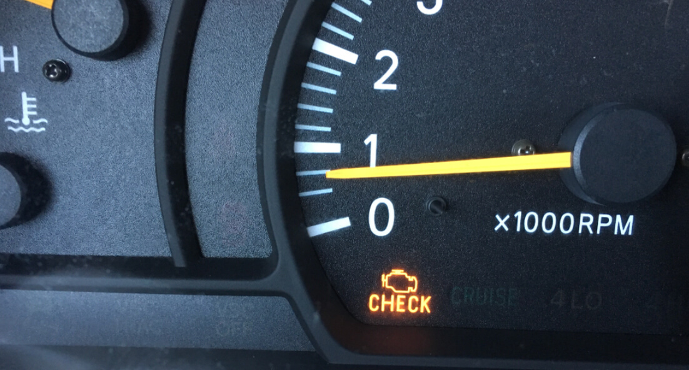
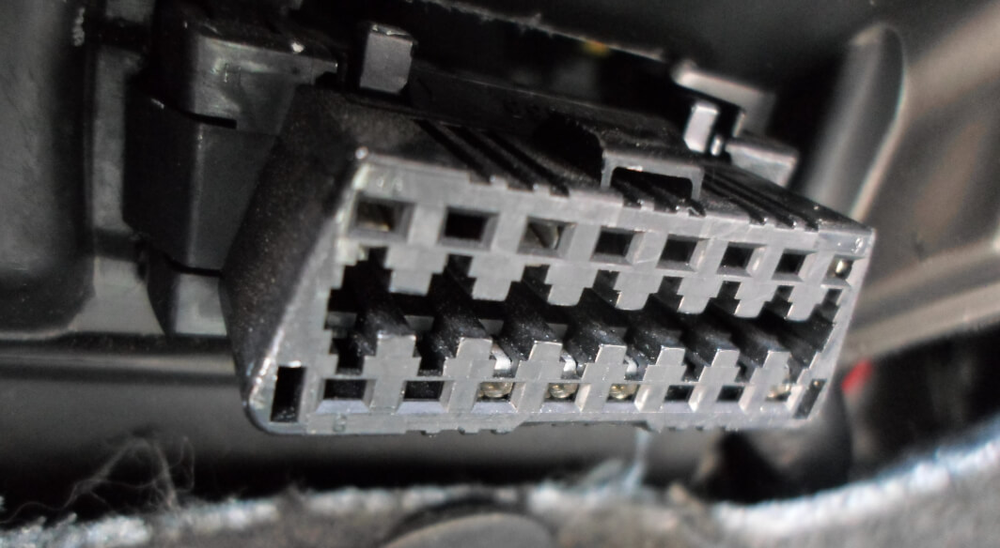
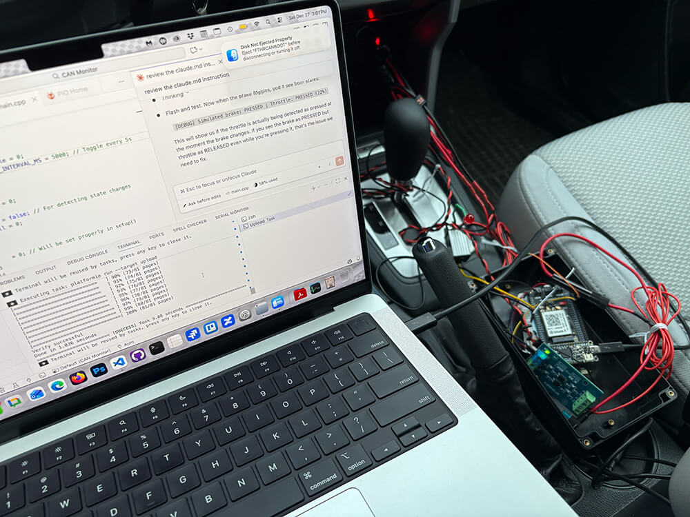
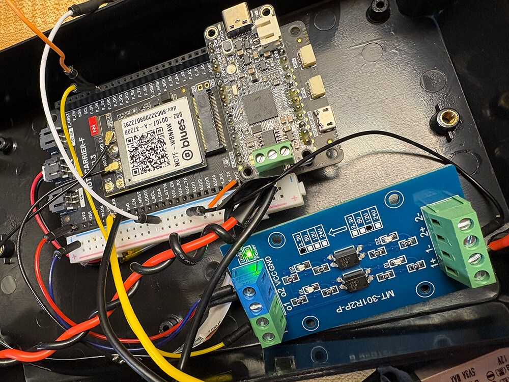
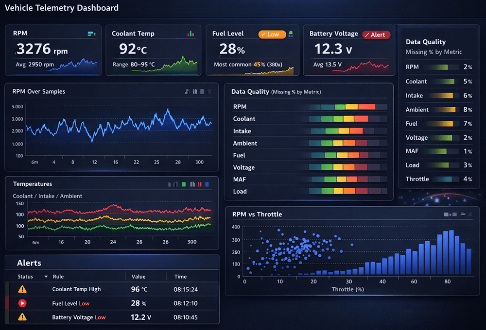

# Monitoring Vehicle CAN Data Over OBD-II with Blues Notecard

Every time that wonderful little "check engine" light illuminates in my car's 
dashboard, I'm reminded there's a whole conversation happening under the hood 
that I may (or may not) want to know about.



Modern vehicles are constantly chattering on the CAN bus, just waiting for us to 
read diagnostic data, and the OBD-II port is an underutilized front-row seat to 
the party:



For this Hackster project, I wanted a small device that could:

1. Attach to any vehicle's standard OBD-II port.
1. Monitor CAN traffic and query standard OBD-II PIDs (i.e. codes used to 
   request diagnostic/sensor data from a vehicle).
1. Read the brake pedal state from a 12V brake signal (you'll understand why 
   later on!).
1. [Sync data over cellular](https://dev.blues.io/cellular-iot/) to populate a 
   cloud dashboard with diagnostic data.

This was also the first IoT project I strictly "vibe coded" (a term I'm starting 
to dislike...), meaning I let 
[Claude Code](https://code.claude.com/docs/en/overview) write all the code (and 
fix the bugs) based on a 
[set of instructions I wrote](https://gist.github.com/rdlauer/bd4ade4452f1a57d0f46fdd3e64ce7aa). 
To improve Claude's ability to properly use the Blues Notecard, I integrated 
the Blues MCP server: 
[Blues Expert](https://dev.blues.io/tools-and-sdks/generative-ai-tools/mcp-servers/).

This turned out to be arguably the only sane way to do it, because "just read 
some CAN data and send it over cellular" quickly turned into _timing, power, 
debouncing, thresholds, and what exactly counts as "pressed" anyway?_

Me literally debugging in the car (actually...me telling Claude what to debug!):

)

## What I Was Trying to Detect (and Why)

The "headline" feature was simple: read diagnostic signals from the car and sync 
that data with the cloud. However, I had a greater desire. I wanted to actually 
**trigger an alert** if both the brake and accelerator are pressed at the same 
time.

Why? Funny you should ask. Turns out a close relative of mine blew out their 
brakes by accidentally pressing both simultaneously. $4000 says that's a bad 
thing.

This ended up being a nice forcing function for me: in this project we have to 
solve brake input, throttle input, CAN/OBD reading reliability, and cloud 
reporting. And yes, this also collects periodic "health-ish" diagnostics (e.g. 
speed, RPM, coolant temp, etc.) on a specific cadence, because once you've got 
access to the bus, it's hard not to ask for a little more.

## Hardware: Simple Stack, Car-Friendly Power

The hardware choices were very intentional: I wanted "durable enough for a car," 
but still very much in the prototype-friendly world.

Here's a top-down look at the hardware. Yes the wiring for this was...difficult.



At the center is an **Adafruit Feather M4 CAN Express** as the host MCU. It 
gives you CAN capability without a pile of external parts.

For **cellular connectivity**, I used a 
[Blues Notecard](https://shop.blues.com/products/notecard-cellular) on a 
[Notecarrier F](https://shop.blues.com/products/notecarrier-f) (which are both 
also available via a [Blues Starter Kit](https://shop.blues.com/collections/blues-starter-kits/products/blues-global-starter-kit)). 
I like this combo because the Notecarrier acts as a base/development board and 
the cloud path ends up boring in the best possible way: your MCU creates JSON 
payloads of arbitrary data, the Notecard handles getting it out of the vehicle, 
and the [Blues cloud service called Notehub](https://notehub.io/) is there 
waiting to receive the data.

**Next was how to power this thing.** Power in vehicles is its own hobby, so I 
tried to keep it as simple as possible:

1. Vehicle 12V --> fused cigarette lighter plug --> 12V-to-5V buck converter.
1. That 5V then feeds the Notecarrier F when the car is running.
1. A LiPo battery, also attached to the Notecarrier F, keeps the system alive 
   for testing or brief off-power moments (and a nice side effect is the vehicle 
   5V will charge the LiPo).

As for the brake signal, this was the trickiest part. Most vehicles give you a 
12V brake line that's `HIGH` when the brake is pressed (whether tapped directly 
or via a fuse). Microcontrollers do not enjoy 12V, so I used a 
**DFRobot 12V-to-3.3V level converter** and brought that into a GPIO pin 
(`D10` in firmware).

Finally, there's a **big obvious red LED** that lights up when any alert 
conditions are met (e.g. the aforementioned simultaneous brake/throttle 
engagement).

## The Firmware: Built in Phases

The firmware was structured around five distinct phases of development:

1. **CAN bring-up:** Before anything else, confirm we can initialize CAN and see 
   traffic.
1. **Brake detection:** Read a stable brake state with proper debouncing.
1. **Throttle detection:** Poll throttle position on a very tight cadence.
1. **Alerting:** Light an LED and send a cloud event immediately when brake AND 
   throttle pressed.
1. **Diagnostics** Collect a set of PIDs every 30 seconds and queue them for 
   periodic sync.

That sounds neat and tidy, but the real story is what happens inside those 
phases.

> NOTE: The entire firmware sketch is available 
> [in this GitHub gist](https://gist.github.com/rdlauer/4fec2db7c47ac72188ddc4307e899caa).

### Reading Throttle Without Lying to Yourself

Throttle position from OBD-II (PID `0x11`) gives a _percentage-ish_ value. In 
practice, you'll see a baseline that isn't always exactly 0% at idle, and it can 
vary by vehicle. Instead of hard-coding "pressed means > 10%" and calling it a 
day, the firmware keeps a **dynamic baseline**:

When the throttle is *not* considered pressed, it updates a moving average 
baseline. Then, a press is detected when current throttle is **some margin above 
baseline**. Finally, a release uses a slightly different threshold so it doesn't 
chatter.

```
      currentThrottlePosition = (data[3] * 100) / 255; // Convert to percentage

      // Dynamic baseline with hysteresis to prevent oscillation
      uint8_t pressThreshold = throttleBaseline + THROTTLE_PRESS_MARGIN;
      uint8_t releaseThreshold = throttleBaseline + THROTTLE_RELEASE_MARGIN;

      // Hysteresis: different thresholds for press vs release
      if (!throttlePressed)
      {
        // Currently released - need to exceed press threshold to become pressed
        throttlePressed = (currentThrottlePosition >= pressThreshold) &&
                          (currentThrottlePosition >= THROTTLE_ABSOLUTE_MIN);
      }
      else
      {
        // Currently pressed - need to drop TO or BELOW release threshold to become released
        throttlePressed = (currentThrottlePosition > releaseThreshold) &&
                          (currentThrottlePosition >= THROTTLE_ABSOLUTE_MIN);
      }

      // Update baseline when NOT pressed (we're at idle)
      // Use exponential moving average: baseline = 0.95 * baseline + 0.05 * current
      if (!throttlePressed)
      {
        throttleBaseline = (throttleBaseline * 95 + currentThrottlePosition * 5) / 100;
      }

      if (!collectingDiagnostics)
      {
        // Only print during normal throttle polling
        if (throttlePressed != lastThrottlePressedState)
        {
          lastThrottlePressedState = throttlePressed;
          Serial.print("[Throttle] ");
          Serial.print(throttlePressed ? "PRESSED" : "RELEASED");
          Serial.print(" (");
          Serial.print(currentThrottlePosition);
          Serial.print("%, baseline:");
          Serial.print(throttleBaseline);
          Serial.println("%)");
        }
      }
```

This is one of those little details that makes the difference between "works on 
my bench" and "works in a car". In my case, throttle is polled about every 
100ms, which is frequent enough to feel responsive.

### Brake Press Detection

The brake input is a digital signal coming from a level-shifted 12V line. While 
you _can_ use a posi-tap connector to tap into the 12V brake line in most any 
vehicle, I think it's easier to tap into the `STOP` brake light fuse (or 
whatever it may be labelled on your car). I accomplished this using an 
**Add-a-Circuit Fuse Tap**. Again, it's still a physical switch in a real 
environment, so debouncing matters.

The firmware performs standard pattern of when the reading changes, reset a 
debounce timer and then only accept the new state if it stays stable for 
`DEBOUNCE_MS`.

```
  // Real brake input from D10
  bool reading = digitalRead(PIN_BRAKE_INPUT);

  // Debounce
  if (reading != lastBrakeReading)
  {
    lastBrakeDebounceTime = millis();
  }

  if ((millis() - lastBrakeDebounceTime) > DEBOUNCE_MS)
  {
    if (reading != brakePressed)
    {
      brakePressed = reading;
      Serial.print("[Brake] ");
      Serial.println(brakePressed ? "PRESSED (12V detected)" : "RELEASED");
    }
  }

  lastBrakeReading = reading;
```

### The Alert: LED + Immediate Cloud Event Sync

When both conditions are `true` (brake pressed AND throttle pressed), the 
device:

1. Turns on the attached Red LED.
1. Prints a very LOUD message to serial (for testing purposes).
1. Syncs a [Note](https://dev.blues.io/api-reference/glossary/#note) (i.e. an 
   event) with the cloud via the Blues Notecard.

There's also a cool down timer so you don't spam alerts if someone holds both 
pedals down for a few seconds. The first alert can fire immediately after boot, 
which is a small but useful touch when you're testing.

On the Notecard side, I used **two Notefiles**:

1. `alerts.qo` for immediate, sync-now events.
1. `diagnostics.qo` for periodic uploads of diagnostic PIDs from the vehicle.

Here is an abbreviated chunk of JSON from an example `alerts.qo` Note:

```
{
  "event": "762c7d9f-7f1f-8d77-bbac-cd4b0f1653e9",
  "when": 1766870690,
  "file": "alerts.qo",
  "body": {
    "alert": "brake_and_accelerator",
    "brake_pressed": true,
    "throttle_percent": 16
  },
  "session": "d38dd1da-f725-4afe-973d-1ca12daac589",
  "transport": "cell:lte:fdd",
  ...
}
```

### Diagnostics: Snapshot Every 30 Seconds

Every 30 seconds, the firmware kicks off a diagnostic "collection cycle." It 
steps through a list of standard Mode 01 PIDs that _should_ be universal for 
modern vehicles and stores the results. Your mileage may vary (pun intended):

* Vehicle speed (`0x0D`)
* Engine RPM (`0x0C`)
* Throttle position (`0x11`)
* Calculated engine load (`0x04`)
* Fuel level (`0x2F`)
* MAF (`0x10`)
* Intake air temp (`0x0F`)
* Coolant temp (`0x05`)
* Ambient air temp (`0x46`)
* Control module voltage (`0x42`)

Because OBD responses can be flaky (or slow, or you might simply miss one), each 
PID request has a timeout. If a PID times out, the cycle keeps moving.

Here is an abbreviated JSON section from an example `diagnostics.qo` Note:

```
{
  "event": "8ea216d6-ced1-8eb0-bcef-22db59d7a840",
  "when": 1766870612,
  "file": "diagnostics.qo",
  "body": {
    "ambient_temp_c": 11,
    "coolant_temp_c": 95,
    "fuel_pct": 69,
    "intake_temp_c": 67,
    "maf_gs": 2,
    "rpm": 1388,
    "throttle_pct": 13,
    "voltage": 14.16
  },
  "session": "a468d9dc-e10c-485e-9cd5-4a2fdcc6f1ee",
  "transport": "cell:lte:fdd",
  ...
}
```

Once the cycle finishes, the firmware queues a single diagnostic Note to 
`diagnostics.qo`. It doesn't force an immediate sync; it relies on the 
Notecard's periodic `outbound` sync settings:

```
  J *req = notecard.newRequest("hub.set");
  if (req)
  {
    JAddStringToObject(req, "product", PRODUCT_UID);
    JAddStringToObject(req, "mode", "periodic");
    JAddNumberToObject(req, "outbound", 30); // Sync every 30 minutes
    JAddNumberToObject(req, "inbound", 60);  // Check inbound hourly

    if (!notecard.sendRequest(req))
    {
      Serial.println("[Notecard] hub.set FAILED");
      return false;
    }
  }
```

### Power Management: Idle on Battery, Active on Main Power

You probably don't want to keep the CAN transceiver and everything else running 
full-time on a small LiPo. So, the firmware periodically checks power state by 
asking the Notecard for what voltage it's receiving via its 
[card.voltage API](https://dev.blues.io/api-reference/notecard-api/card-requests/latest/#card-voltage). 
Based on a threshold, it decides:

* **Main power present?** Assume regular operation when >= 5.0V.
* **Battery-only?** Enter a basic low-power-ish idle mode when < 5.0V.

Idle mode here is intentionally pretty simple as the **CAN is shut down** 
cleanly, the **transceiver is put in standby**, the **CAN boost is disabled**, 
the **LED is turned off**, and the loop just **delays and returns**. The MCU 
stays alive and responsive (and the watchdog is still running), but it stops 
doing some of the power-hungry parts. Not to mention, the Blues Notecard is 
meant to stay powered as it idles at a mere ~8-18uA!

When main power comes back, it re-enables CAN and resumes normal operation. This 
is not "deep sleep," but it's a very pragmatic middle ground for a prototype 
that lives in a car.

## The Cloud Piece

I'm intentionally glossing over what is the most impactful part of this project, 
and that's the cloud integration. With those `diagnostics.qo` Notes being synced 
every 30 minutes with Notehub, I can set up a 
[Notehub Route](https://dev.blues.io/notehub/notehub-walkthrough/#routing-data-with-notehub) 
to send my data to a cloud dashboard (yes, fully vibe-coded as well with Claude 
😅):



Imagine the possibilities when tracking data from all of your vehicles or even 
fleets of cars that need constant monitoring!

## What Worked Well (and What I'd Do Next)

What I like about this build is that it's modular. _Want more data?_ Add your 
own PIDs, or even better, make them remotely updatable using what Blues calls 
[environment variables](https://dev.blues.io/guides-and-tutorials/notecard-guides/understanding-environment-variables/) 
that can sync with your device from the cloud. _Want to add immediate email, 
Slack, or SMS alerts?_ Use Notehub's 
[built-in alerting system](https://dev.blues.io/notehub/notehub-walkthrough/#configuring-notehub-alerts). _Want to add GPS tracking?_ Use the Notecard's 
available on-board GPS.

If you're getting into vehicle data projects, an OBD-II + CAN monitor build is 
a great way to start. You'll touch embedded, automotive power, noisy I/O, and 
cloud reporting all in one device. Again, you can access the full code 
[in this GitHub gist](https://gist.github.com/rdlauer/4fec2db7c47ac72188ddc4307e899caa).

Happy Hacking 💙
